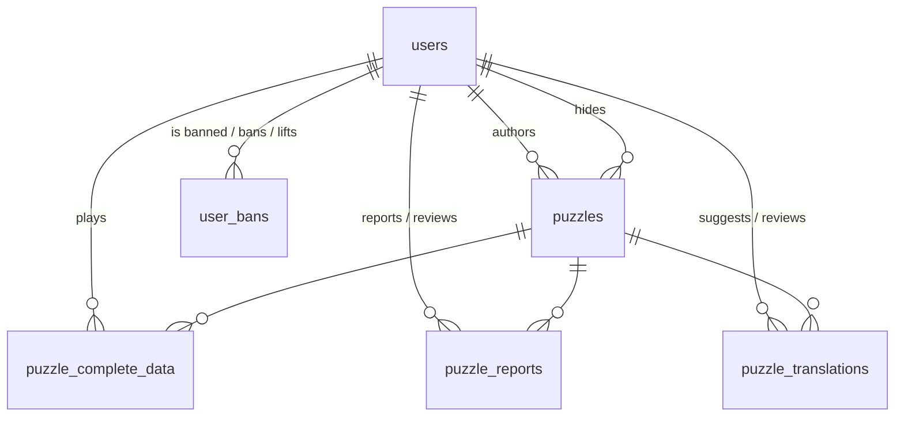

# Data model

Defined in [`prisma/schema.prisma`](../prisma/schema.prisma). SQLite database at `src/database/shapez_gates_db.sqlite`.

## Tables

### `users`

| Column      | Notes                                                  |
| ----------- | ------------------------------------------------------ |
| `id`        | UUID                                                   |
| `name`      | unique, login name                                     |
| `email`     | unique; currently always equal to `name` (not used)    |
| `password`  | bcrypt hash (cost 8)                                   |
| `confirmed` | unused (planned for e-mail confirmation)               |
| `trophies`  | sum of trophies from first completions                 |
| `userRole`  | `0` user, `1` moderator, `2` admin                     |

### `puzzles`

| Column                                 | Notes                                                                                     |
| -------------------------------------- | ----------------------------------------------------------------------------------------- |
| `id`                                   | autoincrement                                                                              |
| `order`                                | position in the official campaign (1..n); `null` for community puzzles                    |
| `author` / `authorName`                | `author = null` ⇒ official puzzle (`authorName = "official"`)                             |
| `shortKey`                             | icon key `io:<inputs>:<outputs>`, computed from `data` (older puzzles had a shapez shape and are converted on startup) |
| `title`, `description`, `locale`       | in the original language; `description` may contain ` `                                |
| `afterCompletingMessage`               | optional text shown after solving (not exposed for translation yet)                       |
| `data`                                 | serialized + compressed puzzle (buildings, signals, expected outputs) produced by the game |
| `minimumComponents`, `maximumComponents` | component count limits shown in-game; `maximumComponents` is an upper bound the player must respect |
| `minimumNands`                         | reserved for "build it only with NANDs" scoring; defaults to `1`, not really used yet      |
| `likes`, `completions`, `downloads`    | counters                                                                                  |
| `averageTime`, `averageDifficultyRating` | running averages over first completions (seconds; 0–2)                                  |
| `difficulty`                           | float in [0, 1] computed by `calculateDifficulty`; `null` until someone completes it      |
| `hiddenAt`, `hiddenById`               | soft-hide by moderation or by too many reports                                            |

### `puzzle_complete_data`

One row per (user, puzzle), **created when the user downloads the puzzle**. `completedAt` is set when they solve it; `timeTaken`, `componentsUsed`, `nandsUsed`, `difficultyRating` (0 easy, 1 medium, 2 hard) and `liked` are overwritten on each completion. Statistics on the puzzle are only incremented on the first completion (like/rating changes are reconciled afterwards).

### `puzzle_translations`

A suggested translation of a puzzle's `title` and `description` into `locale`. Unique per (user, puzzle, locale). `approved = true` translations replace the original text for clients that request that locale. Translations submitted by the puzzle's own author are auto-approved.

### `puzzle_reports`

A user's report on a community puzzle with a free-text `reason`. Moderators set `legit`, `reviewNotes`, `reviewer`, `reviewedAt`.

### `user_bans`

`expiresAt` defines the ban; `liftedAt`/`moderatorLift`/`reasonLifted` record an early lift. A user is banned while there's a ban with `liftedAt = null` and `expiresAt` in the future.

## Official levels

The 26 official levels live in `src/defaultDatabase/shapez_gates_db.sqlite`:

| #  | Title            | #  | Title           |
| -- | ---------------- | -- | --------------- |
| 1  | Welcome          | 14 | Two or more     |
| 2  | NOT gate         | 15 | Odd detector    |
| 3  | AND gate         | 16 | Zero detector   |
| 4  | OR gate          | 17 | Binary encoder  |
| 5  | NAND gate        | 18 | Binary decoder  |
| 6  | NOR gate         | 19 | Half adder      |
| 7  | XOR gate         | 20 | Complete adder  |
| 8  | NOT using a NAND | 21 | Multi bit adder |
| 9  | AND with NANDs   | 22 | Multiplexer     |
| 10 | OR using NANDs   | 23 | Demultiplexer   |
| 11 | NAND using NORs  | 24 | SR Latch        |
| 12 | Three input AND  | 25 | D Latch         |
| 13 | Three input OR   | 26 | JK Flip Flop    |

Each has an approved `pt-BR` translation.

### Workflow to change or add an official level

1. Create the puzzle in the game's puzzle editor and upload it (it will be a community puzzle authored by you).
2. As an admin, call `PUT /v1/moderation/official/:puzzleId` with `{ "position": n }`. The puzzle becomes official (`author = NULL`, `authorName = "official"`) at position `n`; the other levels are renumbered. The same call moves an existing official level.
3. Add translations via `POST /v1/puzzles/translate/:id` and approve them.
4. Copy the database to `src/defaultDatabase/` so new installs get it.
5. Call `GET /v1/puzzles/officialSnapshot` as an admin and save the response over the front-end's `src/js/platform/offlineFallback/officialLevelsDownload.json`, so offline players get the same levels (remove `hiddenAt`/`hiddenById` from each `meta`).

Progression: a player can play every official level up to the first one after the furthest level they completed (by `order`).
